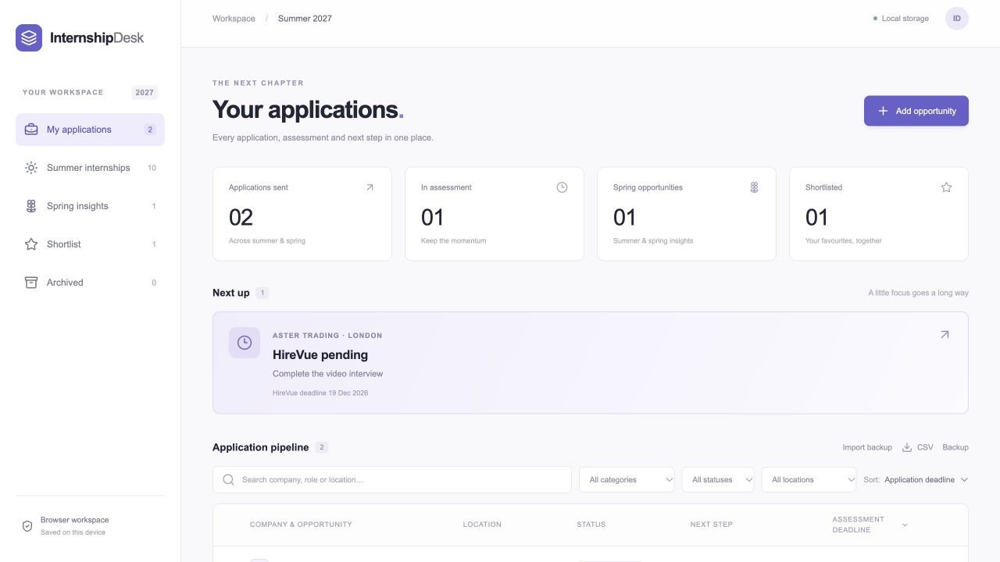

# Internship Desk

A clean, browser-based workspace for internship applications and spring insight programmes. Built from a real application workflow, with separate deadlines for applying and completing assessments.



## Features

- Summer internships, spring insights, shortlist and archived views
- Ten example categories covering finance, quant, technology and consulting
- Search and filter by company, location, category and application status
- Sort application or assessment deadlines, with unknown dates last
- Track HireVue, coding tests, interviews, follow-ups and offers
- Recommend a CV version and keep source links, research notes and contacts
- Remove opportunities and restore them from Archived
- Browser-local saving, JSON backup import/export, and CSV export
- Responsive layout with no account or server required

All bundled companies, roles and dates are **fictional demo data**, not verified openings.

## Quick start

Requires Node.js 22.13 or newer and pnpm 11.25.0.

```sh
pnpm install --frozen-lockfile
pnpm dev
```

Open the localhost address printed in the terminal.

```sh
pnpm test       # persistence and backup validation
pnpm build # type check and production build
pnpm preview
```

## Make it yours

Change the application season in `tracker.config.ts`. Edit `src/demo.json` for your own initial template, or add opportunities in the interface. Initial data is loaded only when this browser has no saved tracker. Updating the demo file does not overwrite saved applications.

The three CV labels are Finance & Risk, Quant & Data, and Consulting & Strategy; change them in `src/Desk.tsx` if needed. Categories are editable in each opportunity.

## Your data

Records are saved in this browser's local storage under `internship-desk.records.v1`. They are not sent to a backend and do not sync between devices. Browser data is not encrypted or protected by a login. Clearing site data or using a different browser loses access to local records unless you exported a backup.

Use **Backup** regularly. **Import backup** merges a JSON export by opportunity ID: matching records are replaced, unrelated records are preserved. CSV is for spreadsheet export, not restoring a full backup. Keep exports containing personal application details out of public repositories.

## Deploy

`pnpm build` creates a static `dist/` folder. Upload its contents to any static host (for example GitHub Pages, Netlify or Cloudflare Pages). Vite uses a relative asset base so repository subpaths work. There are no API keys, platform credentials or private hosting dependencies. This repository does not enable hosting automatically.

## Architecture

React + TypeScript, Vite, Tailwind CSS and Lucide icons. `src/Desk.tsx` contains the interface, `lib/storage.mjs` validates and persists browser data, and `lib/tracker.ts` handles deadline selection/sorting. Unit tests cover persistence, stale revisions, backup merging and invalid input. CI runs tests and a production build.

## License

MIT — see [LICENSE](LICENSE).
